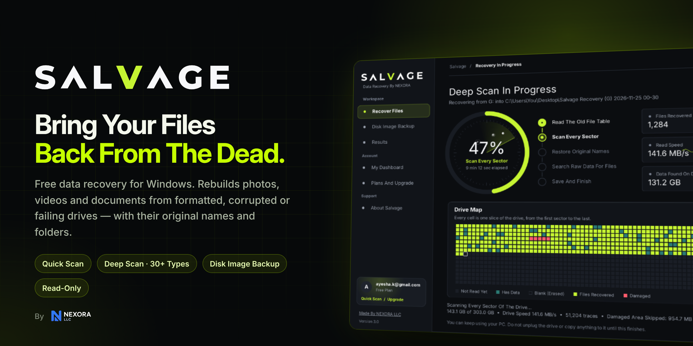
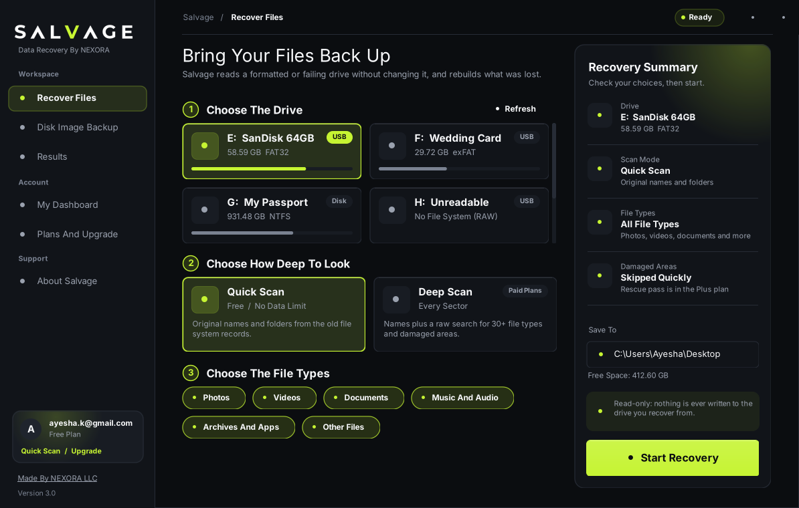
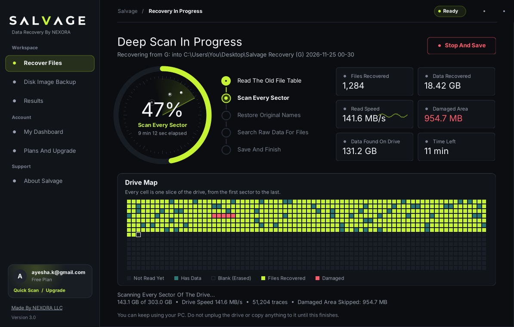
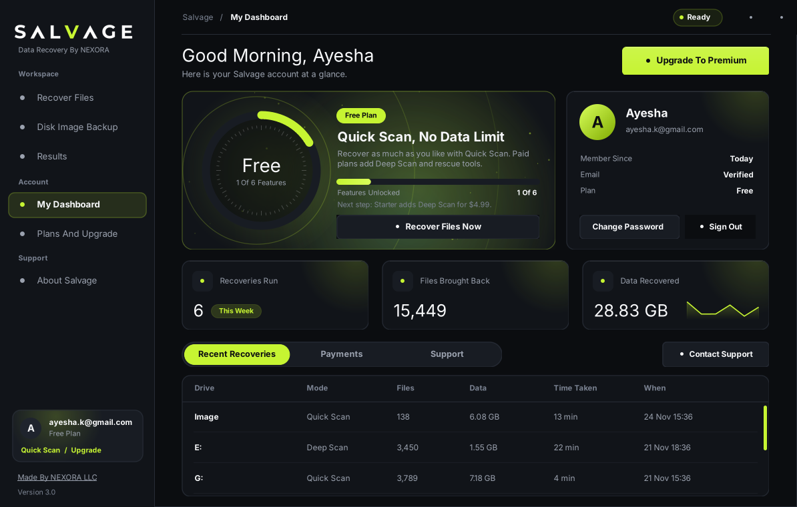

  

### Free Data Recovery For Windows

**Photos, videos and documents back from formatted, corrupted or failing drives — with their original names and folders.**

 

## How It Works

<table>
<tr>
<td width="33%" valign="top" align="center"> <b>1 · Choose</b> Pick the drive, how deep to look and which file types you want.</td>
<td width="33%" valign="top" align="center"> <b>2 · Scan</b> Watch every sector on a live drive map while files are found.</td>
<td width="33%" valign="top" align="center"> <b>3 · Recover</b> Files come back with their names and folders, plus a plain-language report.</td>
</tr>
</table>

 

## Free Vs Premium

| | **Free** | **Premium** |
|---|:---:|:---:|
| Quick Scan (NTFS, FAT32, exFAT) with original names and folders | ✅ | ✅ |
| No limit on how much you recover | ✅ | ✅ |
| Live drive map and recovery report | ✅ | ✅ |
| **Deep Scan** — 30+ file types found in raw data | — | ✅ |
| **Disk Image Backup** for failing drives | — | ✅ |
| **Rescue pass** for damaged areas | — | ✅ |
| Priority support | — | ✅ |

**Premium plans:** 1 Month $4.99 · 3 Months $9.99 · 1 Year $19.99 · Lifetime $34.99

> 🔒 **Read-only by design.** SALVAGE never writes to the drive you recover from — save recovered files to a different drive.

 

## Requirements

Windows 10 or Windows 11.

 

## Repository Contents

| File | Purpose |
| --- | --- |
| `index.html` | Product website ([maxroorr.github.io/nexora-salvage](https://maxroorr.github.io/nexora-salvage/)) |
| `privacy.html` | Privacy Policy |
| `terms.html` | Terms Of Service |
| `refund.html` | Refund Policy |
| `assets/` | Website images, screenshots and fonts |

 

---

SALVAGE is published by 
<a href="https://www.linkedin.com/company/nexorallc-official"><b>NEXORA LLC</b></a>
 © 2026 NEXORA LLC. All rights reserved.

